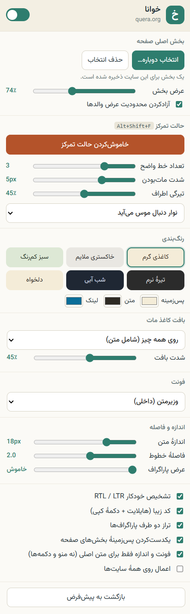

# 📖 Khana Reader | خوانا

**English** · [فارسی](#فارسی)

A Chrome extension (Manifest V3) that makes long reading on the web easier on the eyes,
with first-class support for Persian / RTL text.

## ✨ Features

- 🔤 **Fonts** – bundled Vazirmatn, system fonts, or any installed font by name; adjustable size, line height and paragraph width.
- 🎨 **Eye-friendly themes** – warm paper, soft gray, pale green, soft dark, night blue, or your own colors (instead of harsh white/black).
- 🔄 **Automatic RTL/LTR** – direction is chosen per paragraph, list and table cell by the share of RTL words, not by the first letter. A paragraph that starts in English but is mostly Persian becomes RTL. Inputs use `dir="auto"`, and dynamically added text is handled too.
- 📐 **Pick the main column** – click the content column of any page and widen it (e.g. from the usual 1/3 lock to 70 % of the screen). Remembered per site.
- 📜 **Matte paper texture** – on the page background, on the selected column as a "sheet of paper" with a soft shadow, or over everything.
- 🎯 **Focus mode** – a few lines stay sharp while the rest of the page is frosted. Follows the mouse or stays fixed. Toggle with `Alt+Shift+F`.
- 💻 **Pretty code** – syntax highlighting, always-LTR code blocks, inline code that doesn't break Persian sentences, and a copy button.

## 📸 Screenshots

### Reading View with Paper Texture

 

### Focus Mode (Alt+Shift+F)

 

### Settings Popup

## 🚀 Install (developer mode)

1. Clone or download this repository.
2. Open `chrome://extensions` and enable **Developer mode**.
3. Click **Load unpacked** and select this folder.
4. Open a page, click the Khana icon and turn on the switch for that site.

Tabs that were open before installing need a refresh once.

## 🔒 Privacy

Everything runs locally in your browser. No network requests, no analytics. Settings are stored with `chrome.storage.sync`.

## 📁 Project layout

| File | Purpose |
|---|---|
| `manifest.json` | Extension manifest (MV3) |
| `shared.js` | Defaults, themes, direction detection, color helpers |
| `content.js` | Injected into pages: styling, RTL/LTR, column picker, paper, focus, code |
| `popup.html/css/js` | Settings popup |

## 🤝 Contributing

Issues and pull requests are welcome.

## 👥 Credits

Created by **Milad Shaker**, written with the help of **Claude** (Anthropic).
Bundled third-party components are listed in [THIRD_PARTY_LICENSES.md](THIRD_PARTY_LICENSES.md).

## 📄 License

[MIT](LICENSE) © 2026 Milad Shaker

---

# 📖 خوانا (Khana Reader)

افزونهٔ کروم (Manifest V3) برای اینکه مطالعهٔ طولانی در وب چشم را کمتر خسته کند، با پشتیبانی کامل از متن فارسی و راستبهچپ.

## ✨ قابلیتها

- 🔤 **فونت** – وزیرمتن داخلی، فونتهای سیستم یا هر فونت نصبشده با نام؛ اندازه، فاصلهٔ خطوط و عرض پاراگراف قابل تنظیم.
- 🎨 **تم رنگی راحت برای چشم** – کاغذی گرم، خاکستری ملایم، سبز کمرنگ، تیرهٔ نرم، شب آبی یا رنگ دلخواه، بهجای سفید و مشکی شدید.
- 🔄 **تشخیص خودکار RTL/LTR** – جهت هر پاراگراف، لیست و سلول جدول با درصد کلمات راستبهچپ تعیین میشود، نه اولین حرف. پاراگرافی که با انگلیسی شروع شود ولی بیشتر فارسی باشد RTL میشود. فیلدهای ورودی `dir="auto"` میگیرند و متنهایی که بعداً به صفحه اضافه میشوند هم بررسی میشوند.
- 📐 **انتخاب ستون اصلی صفحه** – روی ستون محتوا کلیک کن و عرضش را بیشتر کن (مثلاً از قفل ۱/۳ صفحه به ۷۰٪). برای هر سایت ذخیره میشود.
- 📜 **بافت کاغذ مات** – روی پسزمینه، روی ستون انتخابشده بهشکل برگهٔ کاغذ با سایهٔ نرم، یا روی همه چیز.
- 🎯 **حالت تمرکز** – چند خط واضح میماند و بالا و پایینش شیشهٔ مات میشود. دنبال موس میآید یا ثابت میماند. با `Alt+Shift+F` روشن و خاموش میشود.
- 💻 **کد زیبا** – هایلایت سینتکس، بلوک کد همیشه LTR، کد داخل جمله بدون بههمریختن متن فارسی و دکمهٔ کپی.

## 🚀 نصب (حالت توسعهدهنده)

1. این مخزن را clone یا دانلود کن.
2. در کروم `chrome://extensions` را باز کن و **Developer mode** را روشن کن.
3. **Load unpacked** را بزن و همین پوشه را انتخاب کن.
4. در هر صفحه روی آیکون خوانا کلیک کن و سوییچ آن سایت را روشن کن.

تبهایی که قبل از نصب باز بودند یکبار باید رفرش شوند.

## 🔒 حریم خصوصی

همهچیز محلی و داخل مرورگر اجرا میشود. هیچ درخواست شبکهای و هیچ ردیابی وجود ندارد. تنظیمات با `chrome.storage.sync` ذخیره میشوند.

## 🤝 مشارکت

Issue و Pull Request پذیرای.

## 👥 سازندگان

ساختهٔ **میلاد شاکر**، با کمک **Claude** (ساختهٔ Anthropic).
کتابخانهها و فونتهای داخل پروژه در [THIRD_PARTY_LICENSES.md](THIRD_PARTY_LICENSES.md) آمدهاند.

## 📄 مجوز

[MIT](LICENSE) © ۲۰۲۶ Milad Shaker

