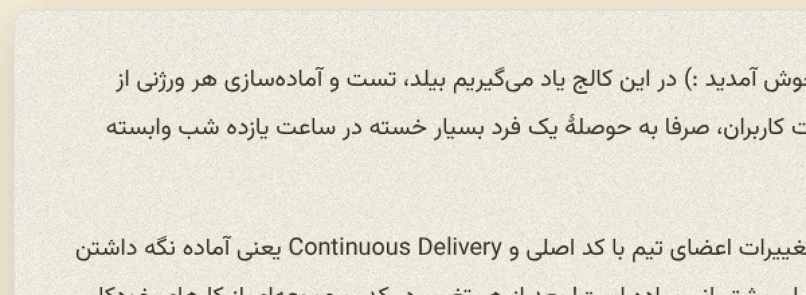
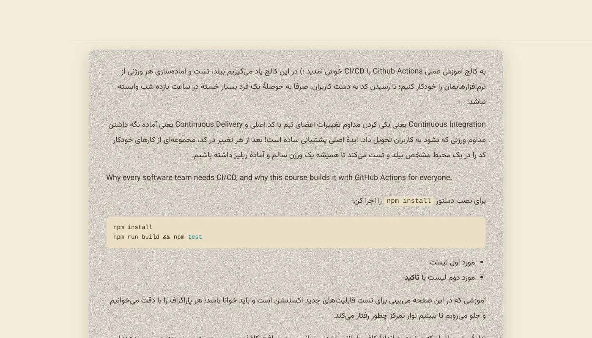
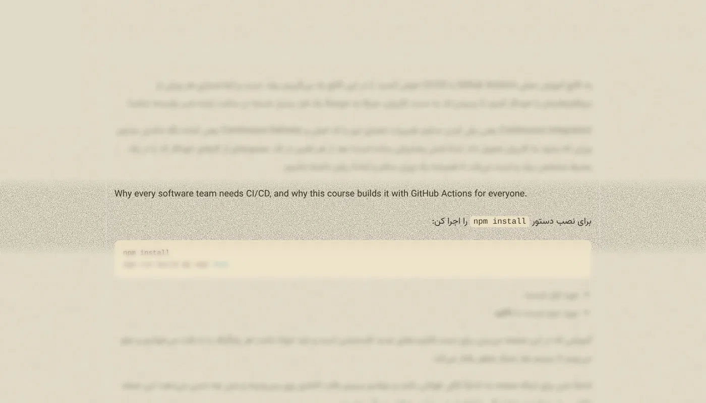

# Khana Reader | افزونه خوانا (v1.1)

> **افزونهٔ مرورگر برای مطالعهٔ لذت‌بخش و بدون خستگی متون فارسی و دوزبانه در وب**  
> *A lightweight Chrome extension designed for comfortable reading, Persian/RTL typography, eye-strain relief, and focus mode.*

---



---

## 🌟 ویژگی‌ها | Features

- 📖 **فونت استاندارد وزیرمتن (Vazirmatn):** جایگزینی خودکار یا انتخابی فونت‌های وب با فونت خوانا و استاندارد وزیرمتن.
- 🔄 **تشخیص خودکار جهت متن (Auto RTL / LTR):** تنظیم هوشمندانهٔ دایرکشن پاراگراف‌ها برای متون ترکیبی فارسی و انگلیسی.
- 🎯 **حالت تمرکز (Focus Mode):** محوسازی هوشمند پس‌زمینه و دنبال‌کردن خطوط مطالعه با نشانگر ماوس (کلید میانبر: `Alt + Shift + F`).
- 🎨 **تم‌های رنگی ضد خستگی چشم (Eye-Care Themes):** تم‌های کاغذی گرم، خاکستری ملایم، سبز کدر، شب آبی و تیرهٔ نرم، به‌همراه امکان انتخاب رنگ‌های دلخواه.
- 📜 **بافت کاغذ مات (Paper Texture):** شبیه‌سازی حس طبیعی مطالعه روی کاغذ برای کاهش بازتاب نور مانیتور.
- 💻 **زیباسازی و هایلایت کدها (Code Highlighting):** نمایش خوانای کدهای برنامه‌نویسی همراه با دکمهٔ کپی سریع با کتابخانه Highlight.js.
- 📐 **کنترل کامل چیدمان:** تنظیم اندازه متن، فاصله خطوط، عرض پاراگراف‌ها و تراز دوطرفه (Justify).

---

## 📸 تصاویر و پیش‌نمایش | Previews

<div align="center">

### حالت مطالعه همراه با بافت کاغذ | Reading View with Paper Texture


<br/>

### حالت تمرکز برای مطالعهٔ عمیق | Focus Mode (Alt+Shift+F)


<br/>

### پنل تنظیمات افزونه | Extension Settings Panel


</div>

---

## 🚀 راهنمای نصب | Installation Guide

### فارسی:
1. پروژه را به صورت فایل فشرده دانلود کرده یا با دستور زیر کلون کنید:
   ```bash
   git clone https://github.com/USERNAME/khana-reader.git
   ```
2. در مرورگر گوگل کروم، آدرس `chrome://extensions` را باز کنید.
3. گزینهٔ **Developer mode** را از گوشهٔ بالا-راست فعال کنید.
4. روی دکمهٔ **Load unpacked** کلیک کرده و پوشهٔ پروژه (`khana-reader`) را انتخاب کنید.
5. روی آیکون افزونه در نوار ابزار کلیک کرده و سوییچ فعال‌سازی را روشن نمایید.

### English:
1. Clone this repository or download the ZIP archive:
   ```bash
   git clone https://github.com/USERNAME/khana-reader.git
   ```
2. Navigate to `chrome://extensions` in Google Chrome or any Chromium-based browser.
3. Enable **Developer mode** in the top-right corner.
4. Click **Load unpacked** and select the extension directory.
5. Click on the Khana Reader icon in the toolbar and toggle it on.

---

## ⌨️ میانبرها | Shortcuts

| میانبر (Shortcut) | عملکرد (Action) |
|---|---|
| `Alt + Shift + F` | فعال / غیرفعال کردن حالت تمرکز (Toggle Focus Mode) |

---

## 🏷️ کلیدواژه‌ها | Topics

`chrome-extension` • `manifest-v3` • `rtl` • `persian` • `farsi` • `reading-mode` • `focus-mode` • `eye-strain` • `vazirmatn`

---

## 💡 قدردانی و توضیحات | Attribution

> *Written with the help of Claude.*
